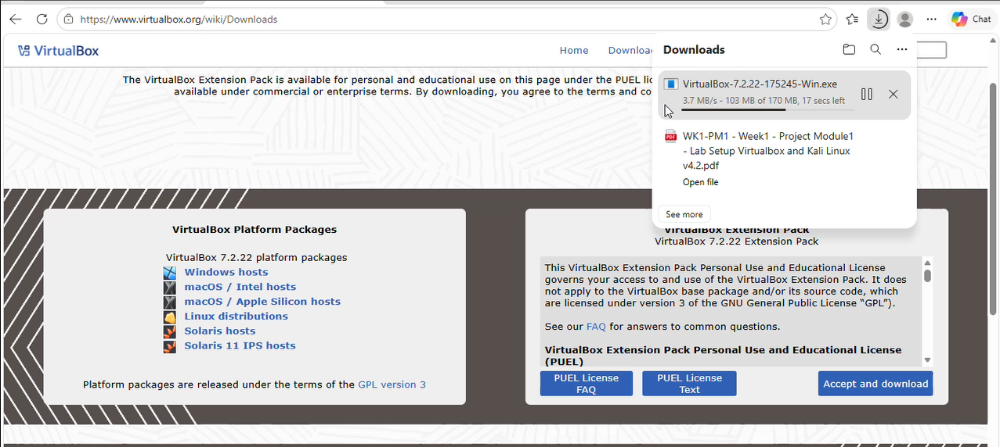
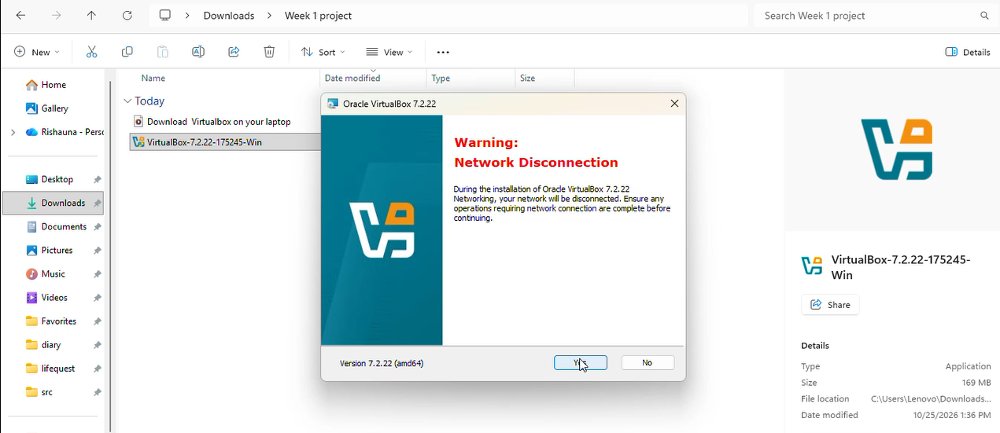
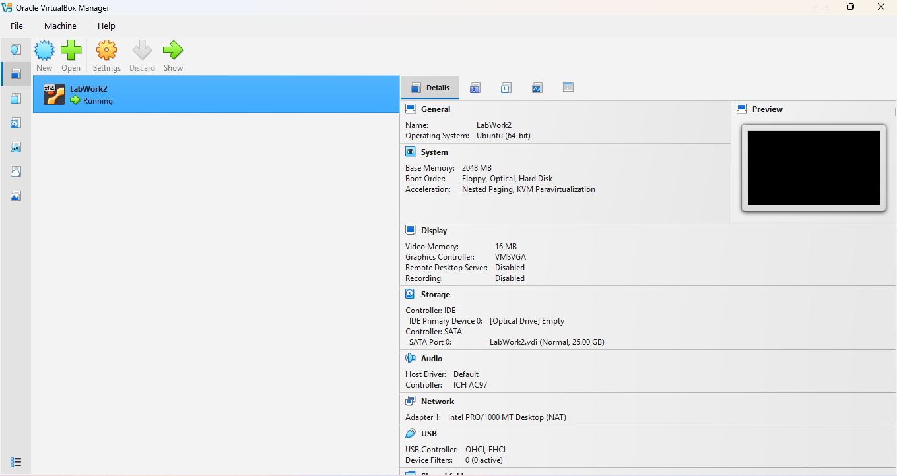
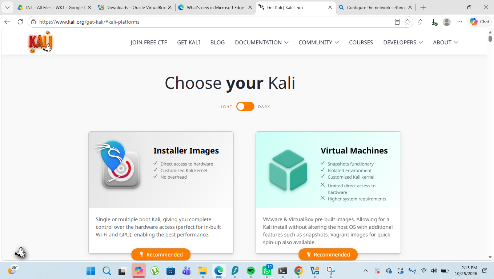
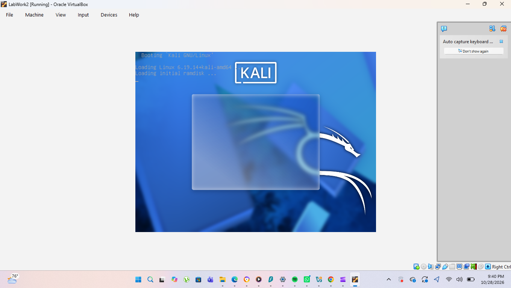
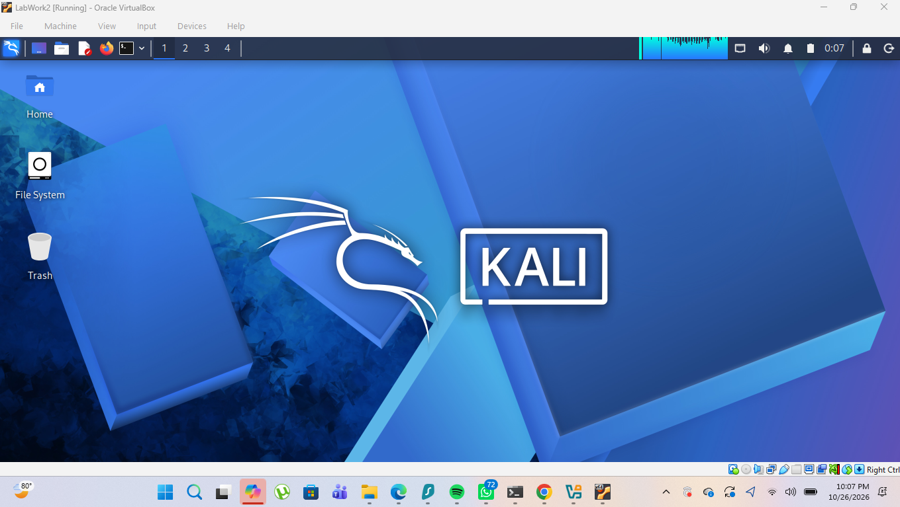
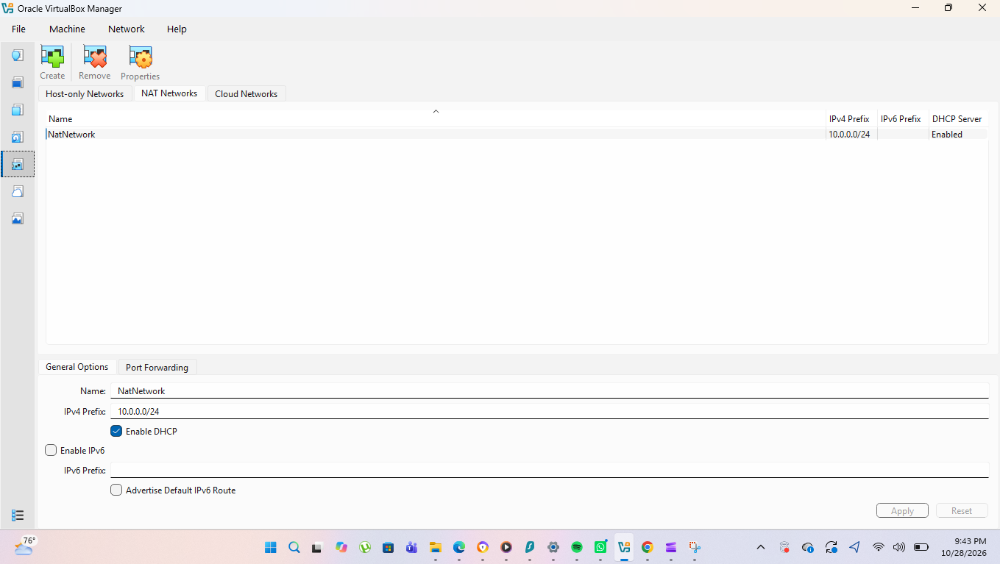
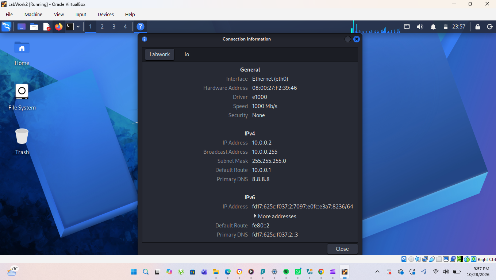

# NETWORKWALKS-B084-WK1-PM1-CYBERSECURITY-LAB-SETUP

## Install and configure VirtualBox.

---

## Install/import Kali Linux as a virtual machine.

---
## Create a private NAT Network for the cybersecurity lab.

---
## Configure the Kali Linux Network

Configure-the-Kali-Linux-Network.png

---

